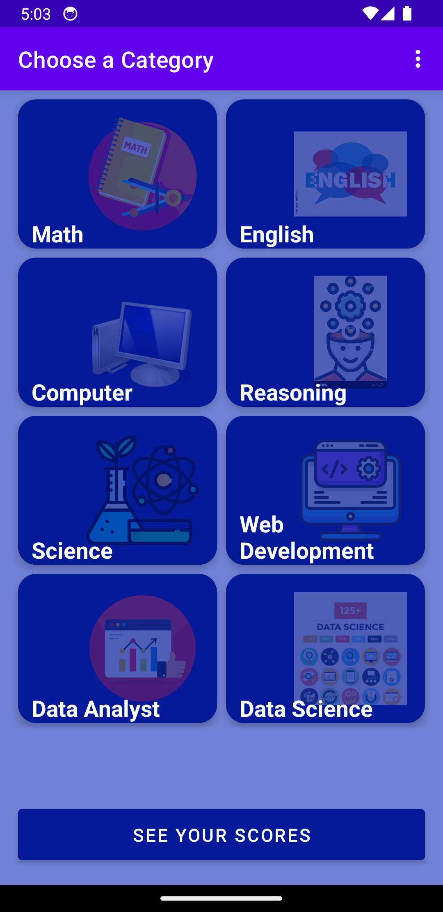
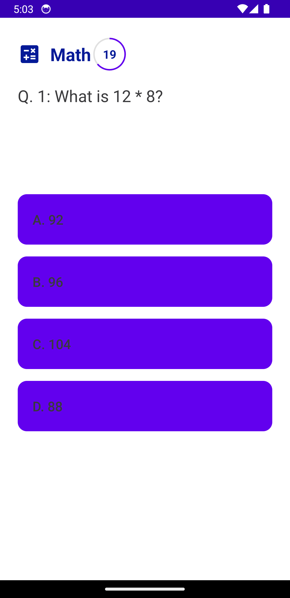
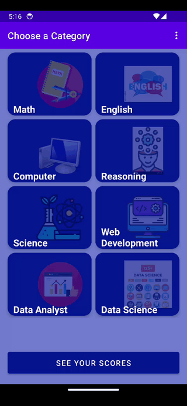

# QuickBank - Android Quiz Application

**QuickBank** is an interactive, category-based quiz application built for Android. It allows users to test their knowledge across multiple subjects including Mathematics, Computer Science, Web Development, Data Science, and more, complete with timed questions, score tracking, and Firebase Authentication.

---

## 🚀 Features

* 🔐 **User Authentication:** Firebase Email/Password Sign Up & Login with persistent login sessions (`SharedPreferences`).
* 📚 **Diverse Quiz Categories:**
  * Math
  * English
  * Computer Science
  * Reasoning
  * Science
  * Web Development
  * Data Analyst
  * Data Science
* ⏱️ **Interactive Timed Quizzes:**
  * 30-second countdown timer per question with a dynamic circular progress indicator.
  * Real-time visual feedback (Green for correct answers, Red for incorrect answers).
* 🏆 **Scoreboard & History:**
  * Saves quiz scores locally per category.
  * Dedicated Scores Activity to view past performance.
* 🎨 **Dynamic UI & Theming:**
  * Custom card layouts, icons, and dynamic color themes matching each quiz subject.

---

## 📱 Screenshots

<p align="center">
  
  
  
</p>

---

## 🎬 App Demo

<p align="center">
  
</p>

*Watch the 20-second walkthrough showcasing category selection, timed quiz interaction with green/red answer feedback, and score tracking.*  
*(Full MP4 Video: [screenshots/demo_video.mp4](screenshots/demo_video.mp4))*

---

## 🛠️ Tech Stack & Prerequisites

* **Language:** Java (JDK 11)
* **Minimum SDK:** `24` (Android 7.0 Nougat)
* **Target / Compile SDK:** `36` (Android 15/16)
* **Architecture:** Android View System (XML layouts, Material Components, CardView)
* **Authentication:** Firebase Authentication
* **Build System:** Gradle (Kotlin DSL - `.gradle.kts`)

---

## 📁 Project Structure

```
quickbank/
├── app/
│   ├── src/
│   │   ├── main/
│   │   │   ├── java/com/reason/quickbank/
│   │   │   │   ├── MainActivity.java     # Session router / Launcher
│   │   │   │   ├── LoginActivity.java    # Firebase Login & Session Save
│   │   │   │   ├── SignupActivity.java   # Firebase Account Creation
│   │   │   │   ├── CategoryActivity.java # Category Selection Grid & Menu
│   │   │   │   ├── QuestionActivity.java # Quiz Engine & CountDownTimer
│   │   │   │   ├── ScoresActivity.java   # Local Scoreboard Display
│   │   │   │   └── Question.java         # Question Data Model
│   │   │   ├── res/                     # Layouts, Drawables, Colors & Themes
│   │   │   └── AndroidManifest.xml
│   └── build.gradle.kts
└── settings.gradle.kts
```

---

## ⚙️ Project Setup & How to Run in Android Studio

Follow these detailed steps to set up and run the **QuickBank** project on your local machine using Android Studio:

### 1. Prerequisites
Before getting started, make sure you have installed:
* **Android Studio** (Flamingo, Giraffe, Iguana, Ladybug, or newer recommended).
* **JDK 11** or higher (comes bundled with modern Android Studio installations).
* **Git** installed on your system.
* An active **Firebase Project** for user authentication.

---

### 2. Step-by-Step Setup Guide

#### Step 1: Clone the Repository
Open your Terminal or PowerShell and run:
```bash
git clone https://github.com/Jogendra2022/quickbank.git
```

#### Step 2: Open Project in Android Studio
1. Launch **Android Studio**.
2. Click **Open** (or `File > Open...`).
3. Navigate to the directory where you cloned `quickbank` and select the root directory.
4. Click **OK** to open the project.

#### Step 3: Sync Project with Gradle Files
1. Wait for Android Studio to automatically index the files and download required dependencies.
2. If prompted, click **Sync Now** in the top bar, or go to `File > Sync Project with Gradle Files`.
3. Ensure the Gradle build completes successfully without errors in the **Build** window.

#### Step 4: Configure Firebase (Authentication Setup)
1. Go to the [Firebase Console](https://console.firebase.google.com/).
2. Create a new Firebase project (or use an existing one).
3. Register a new **Android App** in your Firebase project with:
   * **Package Name:** `com.reason.quickbank`
4. Download the `google-services.json` configuration file.
5. Move the downloaded `google-services.json` file into the `app/` directory of your project:
   `quickbank/app/google-services.json`
6. In the Firebase Console, go to **Build > Authentication > Sign-in method** and enable **Email/Password**.

#### Step 5: Set Up an Android Emulator or Physical Device
* **Using Virtual Device (Emulator):**
  1. Open `Tools > Device Manager` in Android Studio.
  2. Click **Create Device** and select a phone model (e.g. Pixel 7).
  3. Select a System Image (API Level 24 or higher, e.g., API 34/36) and click **Finish**.
* **Using Physical Device:**
  1. Enable **Developer Options** and **USB Debugging** on your Android phone.
  2. Connect your phone via USB cable and grant USB debugging permission when prompted.

#### Step 6: Run the App
1. In the top toolbar of Android Studio, select your target device (`emulator` or physical phone).
2. Ensure the run configuration module is set to **`app`**.
3. Click the green **Run (▶)** button or press `Shift + F10`.
4. The app will build, install, and launch automatically on your device!

---

## 📝 License

This project is open source and available under the [MIT License](LICENSE).
